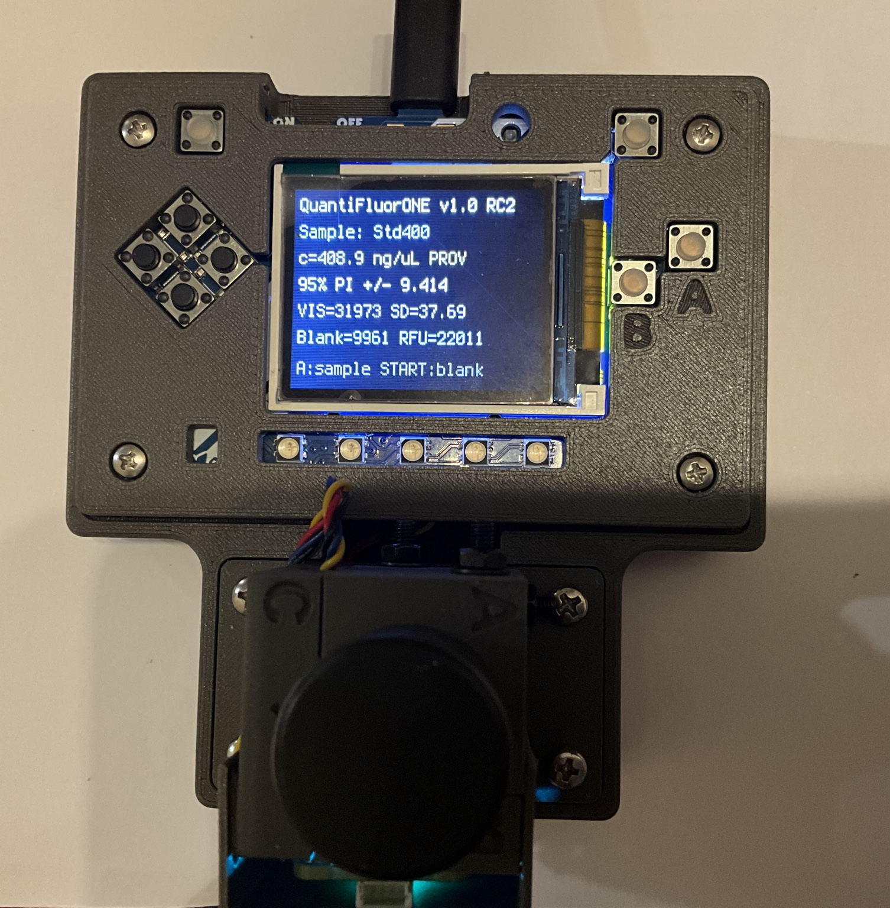

# DIY QuantiFluorONE dsDNA Fluorometer

[Deutsch](README.de.md) · **English**

An open portable instrument for quantifying double-stranded DNA with the
Promega QuantiFluor® ONE dsDNA System. This repository provides the assembly
and operating manual, mechanical and PCB files, firmware, calibration tools
and analytical records needed to reproduce and evaluate the documented build.

**Project author:** Dipl.-Ing. Matthias Birkicht

**Institute:** Centre for Tropical Marine Research

## Start here

- **[Assembly and Operating Manual — PDF](docs/manual/downloads/DIY_QuantiFluorONE_Manual.pdf)** — complete 45-page edition with photographs, file links and clickable chapter contents.
- **[Editable manual — Word](docs/manual/downloads/DIY_QuantiFluorONE_Manual.docx)** — the same edition for reading and annotation.
- **[Manual contents and Quarto sources](docs/manual/README.md)** — fourteen chapters and the rendering procedure.
- **[Launch Calibration Suite v7.3](https://matthiasbirkich.github.io/diy-quantifluorone-dsdna-fluorometer/software/calibration_suite/Open_Fluorometer_Calibration_Suite_v7.3.html)** — runs directly in the browser.

Read the assembly and first-startup checks before powering a new build.
The manual records the remaining physical checks, including the fastener
schedule and cable connections. See the [open items](docs/manual/TODO.md).

## Build and operate

1. Identify the parts using the [component chapter](docs/manual/chapters/04_components_and_files.qmd), [bill of materials](bom/master_bom.csv) and [hardware file index](docs/manual/hardware_file_index.csv).
2. Follow [instrument assembly](docs/manual/chapters/05_assembly.qmd), then [software installation](docs/manual/chapters/06_software_installation.qmd) and [startup checks](docs/manual/chapters/07_startup_and_controls.qmd).
3. Establish the [on-device two-point calibration](docs/manual/chapters/08_calibration.qmd) and verify an independent control.
4. Follow the [routine measurement procedure](docs/manual/chapters/09_routine_analysis.qmd) and [quality-control and reporting instructions](docs/manual/chapters/10_results_and_qc.qmd).

Routine ONE measurements use **1 µL sample plus 200 µL ready-to-use reagent**.
The high-standard solution is **400 ng/µL lambda DNA** (400 µg/mL).
A multipoint series characterizes each new instrument or configuration;
it is not required before every routine batch. The bundled provisional
calibration is not a qualification of a newly built device.

## Documented hardware and software

| Component | Documented configuration |
|---|---|
| Controller | Adafruit PyBadge, product 4200 |
| Detector | TSL2591, positioned at 90° to excitation |
| I²C multiplexer | PCA9546 |
| LED driver | ioRodeo fixed-current radial 16 mA board, ver_0p1_rev_3 |
| Excitation LED | 485 nm |
| Filters | Neemoo Ex470BP-40 and Em532BP-40 |
| Sample tube | Promega E4941 thin-walled 0.5 mL PCR tube |
| LED board holder | E_LED Board + Vial Halter STEP design |
| Bootloader | PyBadge UF2 3.15.0 |
| Runtime | CircuitPython 9.1.1 |
| Instrument firmware | QuantiFluorONE 1.0.0-rc2 |

Use the files and checksums in [software](software/README.md) when reproducing
this configuration. The preserved firmware archive is unchanged by the manual
revision. An assembled LED-board option is described in the component chapter;
component availability and mechanical compatibility must be checked before ordering.

## Calibration tools and analytical evidence

The [Calibration Suite](software/calibration_suite/README.md) supports analysis
of multipoint calibration data and export of a scientific report. Chapter 8
explains CSV preparation, settings, model diagnostics and report saving.
**The v7.3 scientific JSON is not a directly compatible RC2 firmware import.**
This does not prevent characterization in the suite or routine on-device
two-point operation.

For the tested ONE configuration, blank-based screening estimates are approximately
**8 ng/µL LOD and 24 ng/µL LOQ**, on the original-sample basis. The calibration
interval is 0–400 ng/µL; quantitative reporting requires the applicable limits
and satisfactory quality controls. See [analytical performance](docs/manual/chapters/11_performance.qmd)
and the [validation records](validation/README.md) for the comparison with Promega
Quantus, calculations and limitations. These results do not automatically
transfer to another instrument, optical configuration or assay.

## Alternative dye and optical measurements

[Chapter 13](docs/manual/chapters/13_sybr_safe.qmd) describes a literature-based
SYBR Safe transfer procedure. The installed optics are a suitable starting
point, but the assay has not yet been analytically verified on this device.
The published 10 µL sample aliquot is not a minimum-volume requirement;
a smaller-volume procedure needs its own preparation, characterization and calibration.

[Chapter 14](docs/manual/chapters/14_references.qmd) identifies PySpectrometer2
and the Torch Bearer Y2 as options for spectral checks, including the
[ZoidTechnology tools](https://github.com/ZoidTechnology/Torch-Bearer-Tools)
and [Matthias Birkicht's modified fork](https://github.com/matthiasbirkich/Torch-Bearer-Tools).
The manufacturer's Android application is linked as an external download,
not redistributed here.

## Repository map

| Location | Contents |
|---|---|
| [bom/](bom/) | Bill of materials |
| [docs/manual/](docs/manual/) | Authoritative Quarto chapters, current downloads and build instructions |
| [docs/figures/](docs/figures/) | Photographs, drawings and analytical figures |
| [docs/references/](docs/references/) | Bibliography and hardware, source and standards registers |
| [hardware/](hardware/) | Mechanical CAD, meshes, PCB and wiring files |
| [software/](software/) | Installation files, supported firmware and Calibration Suite |
| [validation/](validation/) | Analytical data, calculations and supporting records |

Hardware and software paths are retained so that manual links continue to resolve.
The Quarto chapters are the authoritative text; regenerate PDF and Word after edits.

## Citation and source attribution

Use [CITATION.cff](CITATION.cff) for the archived release and associated
methodological article. That metadata identifies the archived version;
the revised manual does not change the preserved firmware release.

The project builds on ioRodeo Open Colorimeter Plus, the ioRodeo fluorometer
tube holder, DIYNAFLUOR, Adafruit CircuitPython and PySpectrometer2.
Modified mechanical parts were developed collaboratively by Matthias Birkicht
and Florian Bock, 3D-Haven, Bremerhaven, Germany. Chapter 14 provides the
full references and acknowledgements.

## Licences and intended use

Original project material is provided under the [MIT licence](LICENSE), unless
otherwise stated. Preserve the component-specific licences and
[third-party notices](THIRD_PARTY_NOTICES.md); the repository licence does not
replace third-party terms. The separately linked Torch-Bearer-Tools code uses GPL-3.0.

This instrument is intended for research, teaching and method development.
Follow the manual's safety instructions and reagent manufacturers' guidance.
It is an independent DIY project, not an official or endorsed Promega product.
