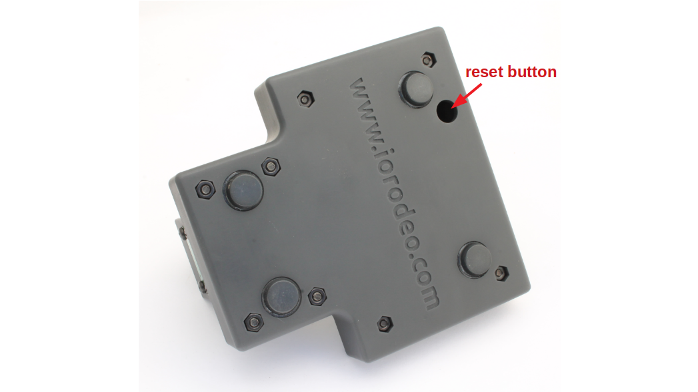
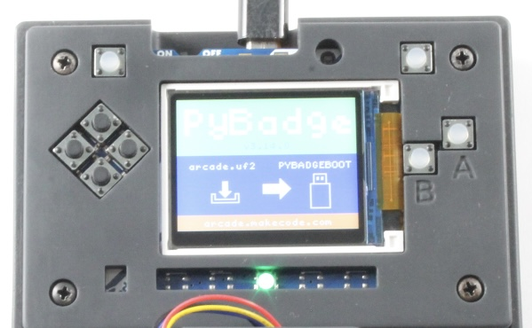

# Software Installation and Updates {#sec-software-installation}

Install the documented software set as a complete release, back up the device before replacing files, and establish an instrument-specific calibration after installation. The preserved firmware archive includes demonstration calibration and saved state files. Their presence does not qualify a newly assembled instrument for sample analysis.

## Supported software files

| Component | Repository file | Use |
|---|---|---|
| PyBadge bootloader 3.15.0 | [UF2 updater](../../../software/bootloader/3.15.0/update-bootloader-arcade_pybadge-v3.15.0.uf2) | Update only when required |
| CircuitPython 9.1.1 | [PyBadge runtime UF2](../../../software/circuitpython/9.1.1/adafruit-circuitpython-pybadge-en_US-9.1.1.uf2) | Runtime for this documented firmware |
| QuantiFluorONE RC2 | [Complete stable RC2 ZIP](../../../software/quantifluorone_firmware/QuantiFluorONE_Firmware_1.0.0-rc2-stable.zip) | Device application, libraries and support files |
| Checksums | [Software SHA256 list](../../../software/SHA256SUMS.txt) | Identify the supplied installation files |

The preserved ZIP is named `QuantiFluorONE_Firmware_1.0.0-rc2-stable.zip`. Its SHA256 digest is `48cc941c12578308e4cb6ec68f8119962941370f60ce40eff16f0564134e97d1`. Keep this archive unchanged. The application declares `QF1-1.0.0-rc2` and displays `v1.0 RC2`; the bundled configuration and saved calibration retain some earlier RC1 metadata. The configuration version string alone therefore does not identify the running application.

Use a computer, a USB Micro data cable and a plain-text editor. A charge-only cable cannot provide file access. The raw bootloader BIN file is an archive/recovery image and is not the file to drag onto the UF2 drive.

## Back up the existing instrument

1. Connect the powered PyBadge to the computer with the USB data cable.
2. Stop the application using CircuitPython safe mode as described below.
3. Copy the complete contents of `CIRCUITPY` into a dated computer folder identified by instrument and firmware version.
4. Confirm that required CSV logs, configuration, saved calibration, multipoint source JSON and state files are present in the backup.
5. Safely eject the drive before resetting or disconnecting the device.

A clean installation removes the previous device state. Keep the backup until the new installation has been checked and required data have been archived. Do not automatically restore old libraries or calibration files over the new installation.

## Reset and drive modes

The reset switch is reached through the opening on the underside of the enclosure. Use a short nonconductive tool without forcing it into the electronics.

{width=65%}

| Action | Mode and computer drive | Purpose |
|---|---|---|
| One reset press | Normal application startup; `CIRCUITPY` when connected to a data host | Start or restart the application |
| Slow second press during startup | CircuitPython safe mode; `CIRCUITPY` | Maintain files with the application stopped |
| Two quick reset presses | UF2 bootloader; `PYBADGEBOOT` or `BADGEBOOT` | Install a UF2 updater or runtime |

For safe mode, press Reset once, allow startup to begin, then press it again during the approximately one-second safe-mode window. Check that the application remains stopped. A fast double-click enters the UF2 bootloader instead. If the boot drive appears unexpectedly, reset once and repeat with slower timing.

The existing image named `circuitpython_safe_mode_screen.jpeg` shows automatic reload and soft-reboot messages. It is not proof of safe-mode entry and is not used here as a safe-mode reference.

## Check the bootloader and install the runtime

1. Enter UF2 bootloader mode with a fast double-click.
2. Open `INFO_UF2.TXT` on the boot drive and record the installed version.
3. If an update to the documented 3.15.0 is needed, copy the supplied UF2 updater to that drive and wait for it to finish. Re-enter the bootloader and verify the version in `INFO_UF2.TXT`.
4. To install CircuitPython 9.1.1, copy the supplied PyBadge runtime UF2 to the boot drive.
5. Wait for the board to restart. Confirm that `CIRCUITPY` appears.
6. Inspect the device-generated `boot_out.txt` for CircuitPython 9.1.1 and board ID `pybadge` after runtime installation.

Do not downgrade a different bootloader merely because it has another version number. A working installation does not need a bootloader update for every application reinstall. The repository also contains an archived `boot_out.txt`; do not mistake a copied historical file for proof of the runtime currently executing.

{width=65%}

## Install the complete application

1. Extract the unchanged RC2 ZIP on the computer.
2. Open the outer folder `QuantiFluorONE_Firmware_1.0.0-rc2-stable`.
3. Confirm that the complete old `CIRCUITPY` drive has been backed up.
4. Enter safe mode and delete the existing contents of `CIRCUITPY`.
5. Copy all files and folders inside the extracted release folder into the root of `CIRCUITPY`. Do not copy the enclosing release folder itself.
6. Confirm that `boot.py`, `code.py`, `quantifluorone_app.py`, `quantifluorone_config.json`, `lib` and `src` are directly in the drive root.
7. Complete the initial-state cleanup below before the first analytical use.

The ZIP remains the preserved release. The initial-state cleanup removes historical instrument data from the installed device without changing the application source or creating another firmware variant.

## Remove the bundled demonstration state

The supplied `quantifluorone_calibration.json` is enabled and identifies the provisional model `QF1-PROVISIONAL-20260731`. The companion multipoint JSON states `dataset_purpose: software_verification` and `calibration_status: PROVISIONAL`. The saved state also contains a historical blank. The application can load these files and calculate concentrations; it does not reject the calibration solely because its status is provisional.

For a new or cleanly reinstalled instrument, while still in safe mode:

1. Preserve the extracted release on the computer as the source record.
2. Remove `quantifluorone_calibration.json` and `quantifluorone_state.json` from the installed `CIRCUITPY` root so an old calibration and blank cannot become the starting state.
3. Remove the bundled `quantifluorone_multipoint.json` from the device root. Retain it on the computer as an example, clearly separated from approved calibration files.
4. Archive and remove any historical measurement CSV copied with the release. Start a new log for the new installation.
5. Keep the configuration, application, libraries and other support files. Do not delete all JSON files indiscriminately.
6. Safely eject the drive, disconnect the USB data host and restart on a suitable standalone supply.
7. Confirm the RC2 banner and use `CAL STATUS` to check that no active calibration remains. If a model is still active, stop and inspect the installed files before accepting results.

A device-specific calibration restored after a reinstall needs documented compatibility with the instrument, assay and software. Restore its matching blank state only as a deliberate decision and check an independent control before reporting samples.

## Select the correct power mode

The supplied `boot.py` checks for a USB data host at startup. With a data host connected, the computer owns write access and the firmware cannot reliably save measurement and calibration files. With a charger, powerbank or suitable LiPo and no data host, the firmware requests write access.

| Task | Required operating arrangement |
|---|---|
| Copy firmware or edit JSON | USB data host; application stopped in safe mode |
| Save a calibration or log measurements | Standalone supply; normal restart after disconnecting the data host |
| Download the resulting CSV | Stop acquisition, connect the data host, enter safe mode and copy files |

Safely ejecting a drive while leaving the USB data connection present does not change the startup decision. Disconnect the data host and restart normally for firmware-side writes. A concentration shown on the display does not prove that a CSV row was saved.

## Verify the installation and persistence

1. Start on standalone power and confirm `QuantiFluorONE v1.0 RC2`.
2. Confirm that no fatal-error screen appears.
3. Perform the startup checks in the following chapter. Record any test measurements as installation checks.
4. After creating the intended calibration, restart and verify that it is retained.
5. Stop acquisition, connect to the computer in safe mode and inspect the new CSV and saved JSON files. Confirm that the expected rows and calibration values are present.
6. Archive this installation check before beginning a reportable sample batch.

This procedure verifies files and persistence on the actual instrument. The source-code review alone cannot verify USB enumeration, reset timing, sensor operation or write access on a particular computer.

## Installation problems

| Observation | Action |
|---|---|
| No drive appears | Check switch position, USB port and data-capable cable |
| Boot drive appears instead of `CIRCUITPY` | Reset once; use slower timing for safe mode |
| Files trigger repeated reloads during copying | Stop the application in safe mode |
| Missing module or missing configuration | Compare the complete installed release with the extracted folder; check that it is not nested |
| RC2 banner but PROV results | Remove or replace the historical provisional calibration through the documented workflow |
| Values display but new CSV rows are absent | Check logging configuration, standalone startup and device write access |
| Failure persists after reinstall | Record the error type, stage and serial traceback; retain the backup and failed installation record |
