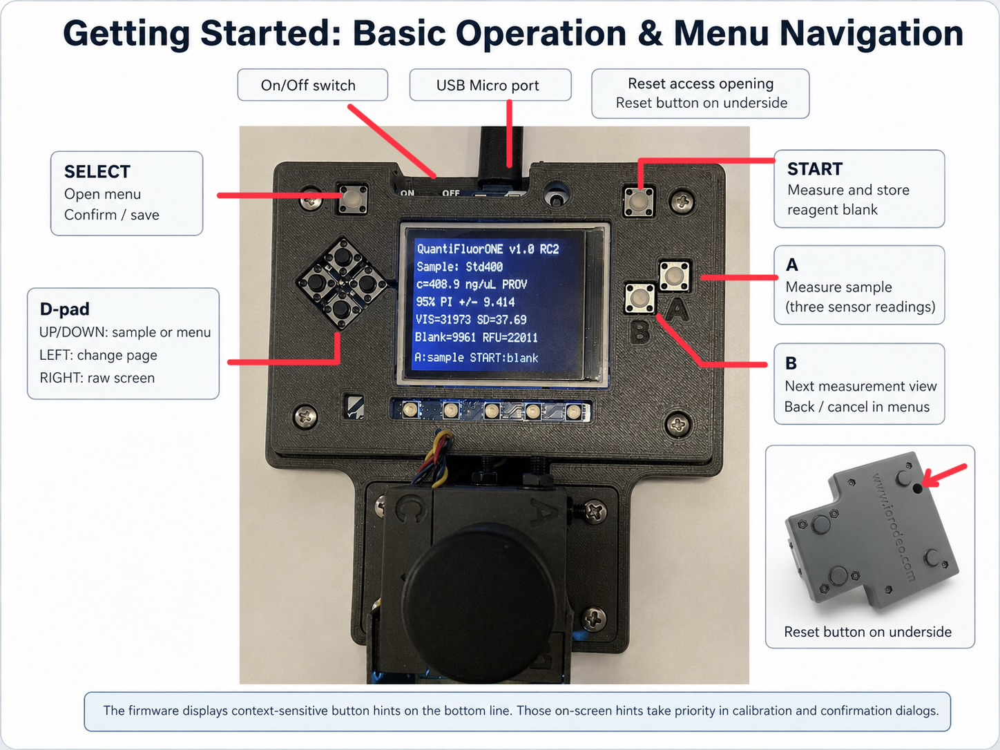

# First Startup and Instrument Operation {#sec-startup}

Use this chapter to verify that the assembled instrument starts, detects its sensor and records measurements with the intended calibration. Hardware checks and a successful software startup precede analytical qualification; samples are reportable only after the calibration and quality-control requirements have been met.

## First startup

1. Complete the assembly inspection, including verified supply and adapter connections. The deferred fastener review remains recorded in the project to-do list.
2. Start on standalone power after disconnecting the USB data host.
3. Confirm the display banner `QuantiFluorONE v1.0 RC2`.
4. Open the menu and inspect `CAL STATUS`. After a clean installation with historical state removed, it should report no active calibration.
5. For a new instrument, measure a test blank and use Details to record the sensor channel, gain and integration time. This is an installation check rather than a calibration.
6. Check shielding and repeated blank response before performing the calibration described in the operating protocol.

The default configuration uses gain `max`, 600 ms integration and three consecutive sensor readings per measurement cycle. The code searches all four PCA9546 branches unless a channel is specified and requires exactly one matching sensor. A configurable direct-sensor fallback also exists; it is not the documented multiplexer build. Investigate a reported channel of `-1` before treating that instrument as the standard configuration.

The earlier operating procedure specifies a 20-minute instrument warm-up. Retain this as the project operating condition and record it. Its sufficiency must be assessed through blank and control stability; the application does not enforce or count down this interval.

## Controls

{width=90%}

| Control | Measurement screen | Menu or calibration screen |
|---|---|---|
| SELECT | Open the menu from Live | Open or confirm the selected action |
| START | Acquire a new reagent blank | Measure the blank requested by the two-point or ten-blank routine |
| A | Measure the selected sample | Measure the high standard when requested |
| B | Cycle Live, Details and RAW | Back or cancel |
| UP or DOWN | Select sample ID in Live | Select menu entry or high-standard concentration |
| RIGHT | Enter RAW from Live or Details; return to Live from RAW | No general menu action |
| LEFT | Change RAW page | Change calibration-result or calibration-status page |

Use the hints on the current screen. UP/DOWN changes the sample ID only in Live. SELECT opens the menu from Live; return to Live first if viewing Details or RAW. The internal button names `gain` and `itime` are historical names: B and A do not change detector gain or integration time in this application.

## Menu functions

| Entry | Purpose | Consequence |
|---|---|---|
| `2-PT CAL` | Acquire blank and one high standard | Saving replaces the active calibration |
| `10-BLANK L/Q` | Evaluate independently prepared blanks | Requires an active two-point calibration; saved estimates belong to that calibration |
| `LOAD MP CAL` | Import compatible OLS calibration JSON | Replaces the active calibration and attaches the current sensor settings |
| `CAL STATUS` | Inspect calibration parameters | LEFT changes between two pages |
| `CLEAR CAL` | Remove the active model after confirmation | Concentrations are no longer available until calibration is established |

Successful import confirms that the required mathematical fields can be read. It does not verify assay identity, independent reference values or analytical approval. RC2 accepts provisional multipoint data; the operator must establish that the model is appropriate before use.

## Handle blank measurements according to calibration type

**In RC2, START on the measurement screen invalidates an active two-point calibration.** The application acquires a fresh blank, disables that model and attempts to delete the saved calibration file. It does not simply substitute a new blank while retaining the two-point slope.

| Intended task | Procedure |
|---|---|
| Create a new two-point calibration | Enter `2-PT CAL`; acquire its requested blank with START, select 400 ng/µL, measure the high standard with A, review and save with SELECT |
| Continue with a stored two-point calibration and its stored blank | Review calibration and unchanged conditions, then measure an independent control with A. Do not press START as a routine preliminary step |
| Check a new blank without replacing the stored two-point blank | Give the tube a traceable sample identifier and measure it with A. Evaluate that check in the QC workflow |
| Deliberately replace the two-point blank | Use a complete new two-point calibration, including the high standard |
| Use an approved multipoint model | Confirm the model and measurement context, acquire the required fresh blank with START and verify an independent control |

Measuring a new blank under a multipoint model retains the imported model. It changes the signal baseline and still requires a control check. The stored model must have been prepared for the same signal definition and assay conditions.

## Follow the two-point dialog

1. Press SELECT from Live, select `2-PT CAL` and open it.
2. Insert the reagent blank, close the shield and press START.
3. On `HIGH STANDARD`, select `400 ng/uL` with UP/DOWN and press SELECT.
4. Insert the incubated high-standard tube and press A. For the confirmed ONE standard, the tube contains 1 µL of 400 ng/µL stock plus 200 µL reagent, corresponding to 400 ng DNA in 201 µL.
5. Review both result pages using LEFT. Check the standard concentration, blank, standard signal, slope and QC indications.
6. Save with SELECT only when the result is acceptable; use B to cancel otherwise.
7. Verify a separately prepared control before unknown samples are accepted.

The code reports `CV`, `SNR` and `SAT` warnings during review but can still save a calibration containing those warnings. Treat warnings as conditions to investigate, not as an automatic acceptance decision. A saved `ACTIVE` status does not replace independent quality control.

## Prepare sample identifiers

In safe mode, edit the `samples.list` array in `quantifluorone_config.json` with a plain-text editor. For example, use the array `["BlankCheck", "QC1", "Sample01", "Sample02"]`. Preserve valid JSON syntax and the remaining configuration.

The selected sample index is stored in `quantifluorone_state.json`, not in a `samples.selected_index` configuration field. After editing the list, restart and explicitly select the correct ID in Live before each measurement. Keep identifiers unique and avoid commas, quotation marks and line breaks: the RC2 CSV writer does not escape those characters.

If the list is unchanged, record the physical samples and their exact measurement order separately. The application records the selected identifier; it cannot determine which tube was inserted.

## Read the measurement views

Each sample cycle collects three consecutive FULL and IR readings and calculates VIS as FULL minus IR, clipped at zero for each reading. The displayed mean and standard deviation describe repeated sensor readings of the same tube, not three independently prepared assays.

| View | Information |
|---|---|
| Live | Sample ID, concentration/status, prediction interval or limits, VIS mean and SD, blank and RFU |
| Details | FULL, IR and VIS statistics, RFU, concentration, sensor channel, gain and integration time |
| RAW | Individual readings over two pages, VIS statistics and peak-related indication |
| Calibration status | Two-point standard, RFU, slope and QC, or multipoint model, coefficients, range, limits and statistical parameters |

The calibration ID is stored in JSON but is not shown on the RC2 calibration-status pages. Identify it from the archived calibration file and batch record. The interface truncates text to fit the screen, so full identifiers and metadata must be checked in the files where necessary.

An out-of-range or provisional result may still have a numerical concentration. Review its status and applicable range before reporting it. A numerical display is not an analytical acceptance flag.

## Record and verify data

| File on `CIRCUITPY` | Role |
|---|---|
| `quantifluorone_config.json` | Hardware, measurement, sample-list and assay configuration |
| `quantifluorone_state.json` | Saved blank and interface selections |
| `quantifluorone_calibration.json` | Active saved calibration |
| `quantifluorone_multipoint.json` | Source JSON for deliberate multipoint import |
| `quantifluorone_log_v100rc2.csv` | Appended measurement records |

The CSV field `t_s` is the monotonic runtime clock in seconds, not UTC or a calendar timestamp. Record the batch date, instrument identity and restart boundaries separately. Time values restart when the device restarts, and rows from several sessions can be appended to one file.

The Live screen does not consistently expose CSV write failures. Verify logging during installation by retrieving the file and checking the expected new rows. Retain that verification when computer access is unavailable during the actual measurement batch.

1. Complete acquisition and stop taking measurements.
2. Connect to the computer and enter safe mode.
3. Copy the CSV, current calibration JSON, configuration and relevant source calibration into the dated batch folder.
4. Confirm sample IDs, row count, firmware, sensor settings, calibration status, result flags and units.
5. Safely eject before disconnecting. Return to standalone power and restart if further measurements are needed.

## Ready for analytical work

Proceed to sample analysis when the instrument starts without error, the expected sensor settings are documented, shielding and blank stability pass, logging has been verified, and a suitable calibration has passed an independent control check. Preserve the calibration and batch record together. The detailed calibration, assay preparation and acceptance criteria follow in the operating chapters.
