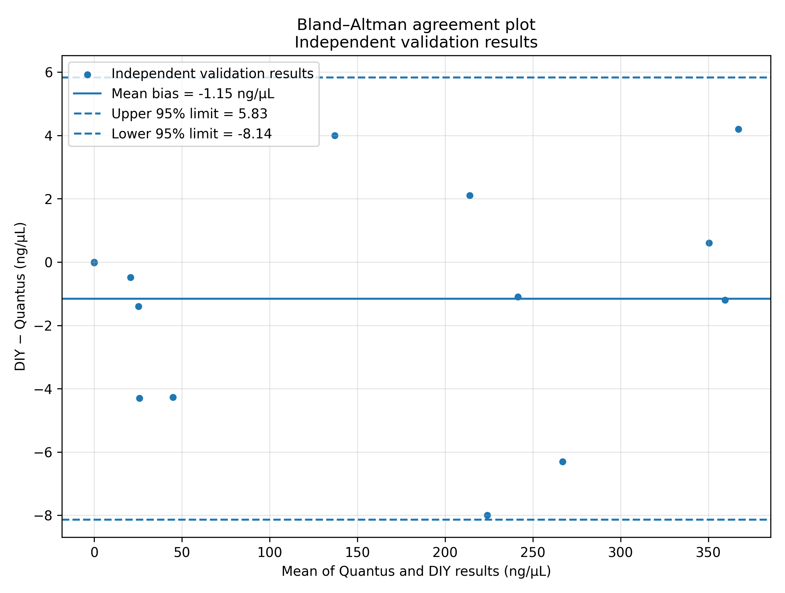
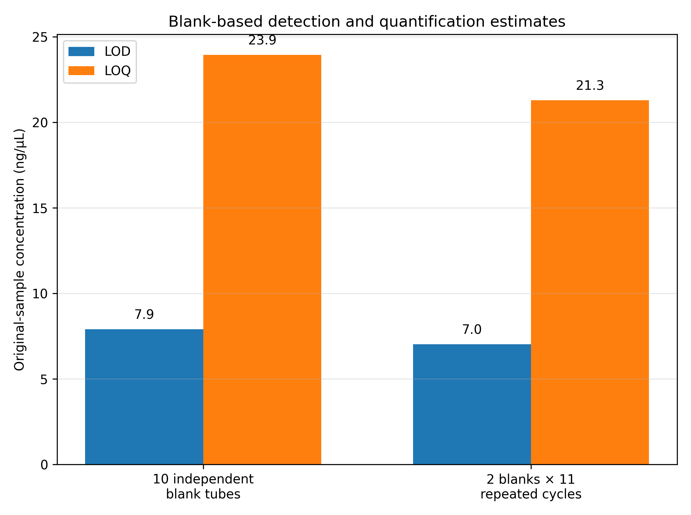

# Analytical Performance and Limitations {#sec-performance}

The reported performance describes the evaluated QuantiFluor ONE instrument configuration using 1 µL DNA solution plus 200 µL reagent and routine two-point calibration. The evidence consists of a Quantus comparison, independent reagent-blank preparations and technical sensor repeats. It does not establish identical performance for every reproduced device, another dye or changed optics.

## Initial characterization and routine use

Characterize each new device or changed configuration using an assigned concentration series and the Calibration Suite to document regression and relevant performance measures. Retain the resulting data and conclusions as the basis for the accepted working range. This is separate from routine sample analysis, which uses the two-point calibration.

The provisional development dataset is not a calibration that must be loaded for each sample batch. Routine controls check continued suitability of the established method. Repeat relevant characterization when configuration changes or unresolved QC findings call that suitability into question.

## Comparison design

The study used separately prepared nominal 400 ng/µL lambda-DNA calibration standards for the DIY instrument and Quantus. The DIY standard measured 395 ng/µL on the Quantus. Its assigned value was retained at 400 ng/µL for the DIY two-point calibration.

Fifteen paired values were recorded. The upper DIY two-point anchor was shown in the comparison but excluded from the independent regression, leaving **14 paired results**. Here, independent means independent of that fitted anchor; it does not mean that every result represents a separately extracted sample or an independently prepared assay replicate.

The Quantus provides an external comparison scale. It is not treated as a traceable reference method or as an error-free definition of the true concentration. Agreement assesses comparability under the tested conditions; it does not alone establish analytical trueness.

## Response across the tested range

The stored comparison analysis gives a slope of approximately **1.003**, an intercept of approximately **−1.64 ng/µL** and **R² = 0.999387** for DIY concentration against Quantus concentration, excluding the upper anchor. These values support an approximately linear relationship over the tested interval.

{width=90%}

High R² is not sufficient proof that a method is linear under all conditions. Inspect residuals and independently assigned concentrations during characterization. Technical repeats on one tube cannot substitute for independent assay preparations when evaluating preparation variability or lack of fit.

A plot of RFU against concentrations calculated from that same RFU and the same calibration equation is an arithmetic-consistency check. Its near-perfect fit is expected mathematically and is not independent evidence of analytical linearity.

## Agreement with the comparison instrument

| Measure | Rounded result and scope |
|---|---|
| Paired results excluding the upper calibration anchor | 14 |
| Mean difference, DIY minus Quantus | Approximately −1.2 ng/µL |
| Mean absolute difference | 2.71 ng/µL |
| Root mean squared difference | 3.62 ng/µL |
| Mean absolute relative difference | 3.79%, for the subset with Quantus concentration at or above the primary LOQ |
| Approximate 95% limits of agreement | −8.14 to +5.83 ng/µL |

{width=90%}

The 3.79% value is a mean absolute relative difference for the specified subset. It is not a universal maximum error, a confidence interval or a guaranteed accuracy specification for another instrument. The limits of agreement describe this dataset and should not be adopted automatically as QC limits.

## Blank performance and low-level reporting

Ten independently prepared reagent blanks were each measured in one cycle of three sensor readings. The primary study reports a mean VIS signal of 9,557.563 counts and an SD of cycle means of 126.514 counts. The corresponding blank-based limits are:

| Concentration basis | LOD estimate | LOQ estimate |
|---|---:|---:|
| Original DNA solution | 7.902 ng/µL | 23.946 ng/µL |
| Prepared assay using a 201-fold dilution | 0.03931 ng/µL | 0.11913 ng/µL |

The concise operational values are approximately **8 ng/µL LOD and 24 ng/µL LOQ on the original-sample basis**. They derive from the documented blank-based calculation and the evaluated calibration slope. They must not be transferred uncritically to another device or configuration.

Two further independent blank preparations were measured in eleven cycles each. Their confirmatory estimates were 7.027 and 21.294 ng/µL. These are 22 cycles on two preparations, not 22 independent blank preparations.

{width=85%}

The blank-sigma estimates are distinct from a full calibration-curve limit calculation under DIN 32645. Identify the calculation method whenever reporting LOD or LOQ. A displayed limit is not evidence of preparation precision or acceptable recovery at that level.

## Repeatability and practical range

Three consecutive readings within one cycle characterize short-term sensor repeatability. They do not include separate pipetting, extraction or sample variability. Use independently prepared tubes to assess assay precision.

The documented calibration interval is 0–400 ng/µL on the original-sample basis. Approximately 24–400 ng/µL is the quantitative reporting interval suggested by the primary LOQ, subject to blank, QC and other acceptance conditions. The blank endpoint remains part of calibration even though it is not a quantitative sample result.

Above-range or saturated samples need predilution and a new assay. Below-LOQ results need the stated qualified reporting category. Matrix effects, DNA fragment size, reagent condition, temperature, tube seating and optical changes may affect the response and require assessment for the intended application.

## Evidence and reproduction files

Retain the [paired comparison data](../../../validation/quantus_diy_two_point_comparison.csv), [stored statistics](../../../validation/validation_statistics.csv), [blank summary](../../../validation/blank_performance_summary.csv), [technical-repeat summary](../../../validation/diy_triplicate_concentration_summary.csv) and [original measurement log](../../../validation/quantifluorone_log_v100rc2.csv).

The [analysis script](../../../validation/validation_and_analytical_performance.py) reproduces core comparison statistics and basic figures using the supplied [requirements](../../../validation/requirements.txt). It does not recalculate the blank limits from the original blanks or fully regenerate every annotated technical-repeat figure in this chapter. Preserve those additional preparation and figure-generation records when extending the characterization.
