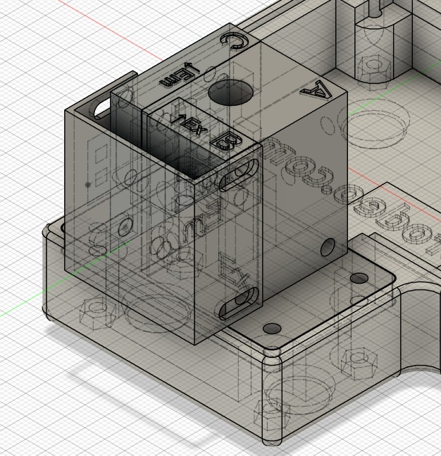

# Komponenten Werkzeuge und Fertigungsdateien {#sec-components}

Dieses Kapitel beschreibt die Komponenten und Dateien für den Aufbau der QuantiFluor ONE-Konfiguration. Das Gerät enthält einen TSL2591-Detektor, eine Anregungs-LED mit 485 nm sowie getrennte Anregungs- und Emissionsfilter. Diese Konfiguration beibehalten, wenn die dafür ermittelten Kalibrier- und Leistungsangaben verwendet werden.

{width=90%}

## Elektronik und Optik

| Anzahl | Komponente | Kennzeichnung und Funktion |
|---|---|---|
| 1 | Adafruit PyBadge | Produkt 4200; Steuerung, Anzeige und Tasten; dokumentierte Laufzeitumgebung CircuitPython 9.1.1 |
| 1 | Adafruit PCA9546 | Produkt 5664; vierkanaliger I²C-Multiplexer; Adresse am vorgeschalteten Bus 0x70 |
| 1 | Adafruit TSL2591 STEMMA QT | Produkt 1980; Fluoreszenzdetektor; Adresse 0x29 am gewählten nachgeschalteten Kanal |
| 1 | ioRodeo-Konstantstromplatine für radiale LEDs | radial_16mA, Revision ver_0p1_rev_3; nomineller LED-Strom 16 mA |
| 1 | Radiale Anregungs-LED | 5 mm; 485 nm; Artikel 1030055 in der Projektstückliste |
| 1 | Anregungsfilter | Neemoo Ex470BP-40; 8 × 8 × 1 mm; zwischen LED und Röhrchen |
| 1 | Emissionsfilter | Neemoo Em532BP-40; 8 × 8 × 1 mm; zwischen Röhrchen und Detektor |
| Nach Bedarf | Probenröhrchen | Dünnwandige Promega E4941 PCR-Röhrchen, 0,5 mL |
| 1 | Adapter am vorgeschalteten Bus | SparkFun PRT-15109, Qwiic-zu-Grove-Adapter |
| Nach Bedarf | Interne Kabel | Vieradrige JST-SH-Kabel, STEMMA QT / Qwiic |
| 1 | USB-Datenkabel | USB-Micro-Anschluss am PyBadge |
| Optional | Mobile Stromversorgung | Geeignete USB-Powerbank oder kompatibler 3,7-V-LiPo-Akku |

Die LED-Platine besitzt keine I²C-Adresse. Ihre SDA- und SCL-Anschlüsse führen den Bus durch; die Firmware wählt keine LED-Adresse an. Der Multiplexer wählt den Buszweig des Sensors.

Die [Hauptstückliste](../../../../bom/master_bom.csv) enthält die erfassten Beschaffungsangaben. Die Kosten sind historische Einträge und keine aktuellen Angebote. Kabelanzahl, Befestigungsmittel und gegebenenfalls Akkukapazität vor Bestellung eines vollständigen Satzes mit dem tatsächlichen Aufbau abgleichen. Die offenen Abweichungen sind im Prüfverzeichnis dokumentiert.

## Optional fertig bestückte LED-Platine

Um den Lötschritt bei der Gerätemontage zu vermeiden, kann die LED-Treiberplatine einschließlich der vorgesehenen Anregungs-LED fertig bestückt bei einem Leiterplatten-Bestückungsdienst wie PCBWay oder JLCPCB bestellt werden, sofern die benötigten Komponenten und Bestückungsoptionen verfügbar sind. Vor der Bestellung Boardrevision, LED-Wellenlänge, Betriebsstrom, Polarität und mechanische Passung zum dokumentierten optischen Modul prüfen. Die Bestückung der Anregungs-LED muss ausdrücklich Bestandteil des Auftrags sein, einschließlich ihrer vorgesehenen rückseitigen Montageposition und Ausrichtung. Die mitgelieferten SMD-Bestückungsdateien allein belegen nicht, dass die radiale LED mitbestückt wird.

## Mechanische Bauteile und Dateien

STEP-Dateien sind bearbeitbare CAD-Austauschdateien. STL-Dateien enthalten Netzdaten für Slicer und 3D-Druck. Die folgenden Verweise führen zu den tatsächlichen Repository-Dateien. Ein Dateiname allein belegt keine identische Geometrie zweier Revisionen.

| Bauteil | STEP-Konstruktion | STL für den Druck | Auswahlhinweis |
|---|---|---|---|
| A Grundkörper und Röhrchenhalter | [A v13](../../../../hardware/mechanical/step/A_Main_Body_modified_v13.step) | [A-Netz](../../../../hardware/mechanical/stl/A_Main_Body_modified.stl) | Röhrchenführung und optische Ausrichtung |
| B Anregungsgehäuse | [B-Konstruktion](../../../../hardware/mechanical/step/B_Excitation_Housing_modified.step) | [B-Netz](../../../../hardware/mechanical/stl/B_Excitation_Housing_modified.stl) | Filtergehäuse auf der LED-Seite |
| C Emissionsgehäuse | [C v3](../../../../hardware/mechanical/step/C_Emission_Housing_modified_v3.step) | [C-Netz](../../../../hardware/mechanical/stl/C_Emission_Housing_modified.stl) | Gehäuse auf der Detektorseite |
| D Emissionsblende | [D-Konstruktion](../../../../hardware/mechanical/step/D_Emission_Baffle.step) | [D-Netz](../../../../hardware/mechanical/stl/D_Emission_Baffle.stl) | Detektoröffnung und Lichtabschirmung |
| E Kombinierter LED-Platinen- und Röhrchenhalter | [E des dokumentierten Aufbaus](../../../../hardware/mechanical/step/E_LED%20Board%20%2B%20Vial%20Halter.step) | Aus STEP exportieren | Vom Autor als tatsächlich verwendeter Halter bestätigt |
| E Dünner Alternativhalter | [Dünne Ausführung](../../../../hardware/mechanical/step/E_LED_Board_holder_thin.step) | [Dünnes Netz](../../../../hardware/mechanical/stl/E_LED_Board_holder_thin.stl) | Beibehaltene Alternative; nicht der Halter des dokumentierten Aufbaus |
| E Alternativhalter | [Alternative Konstruktion](../../../../hardware/mechanical/step/E_LED_Board_holder_alternative.step) | [Alternatives Netz](../../../../hardware/mechanical/stl/E_LED_Board_holder_alternative.stl) | Beibehaltene Alternative; kein zusätzlich benötigtes Bauteil |
| F Optische Abdeckung | [F-Konstruktion](../../../../hardware/mechanical/step/F_Cover_Fluorometer_Optics.step) | [F-Netz](../../../../hardware/mechanical/stl/F_Cover_Fluorometer_Optics.stl) | Lichtabschirmung |
| Controllergehäuse | [Gehäuse v1r4](../../../../hardware/mechanical/step/colorimeter_enclosure_v1r4.step) | Aus STEP exportieren | Im geprüften Verzeichnis ist keine entsprechende Gehäuse-STL enthalten |
| Controllerdeckel | [Deckel v1r4](../../../../hardware/mechanical/step/pybadge_cover_v1r4.step) | Aus STEP exportieren | Im geprüften Verzeichnis ist keine entsprechende Deckel-STL enthalten |

Der kombinierte LED-Platinen- und Röhrchenhalter ist das Standardbauteil E; der Autor hat seine Verwendung am 23. Oktober 2026 bestätigt. Eine passende STL dieses kombinierten Modells liegt im geprüften Verzeichnis nicht vor. Die dünne und die alternative E-Netzdatei gehören zu anderen Modellen und dürfen nicht als dessen Druckdatei eingesetzt werden. Alle Varianten sind im [Dateiverzeichnis](../../hardware_file_index.csv) aufgeführt.

Die sieben optischen STEP/STL-Paare lassen sich öffnen beziehungsweise auslesen. Ihre Gesamtabmessungen stimmen unter Berücksichtigung der Achsenreihenfolge auf 0,01 mm überein. Dies prüft die Dateikonsistenz, belegt aber weder identische Oberflächen noch Druckbarkeit oder Passung am realen Gerät.

{width=65%}

## Leiterplatten und Fertigungsunterlagen

Für die eingebaute radiale ioRodeo-Platine enthält das Repository den [KiCad-Schaltplan](../../../../hardware/pcb/LED_board_iorodeo/kicad/radial_16mA.kicad_sch), die [KiCad-Leiterplatte](../../../../hardware/pcb/LED_board_iorodeo/kicad/radial_16mA.kicad_pcb), das [Fertigungsarchiv](../../../../hardware/pcb/LED_board_iorodeo/i_control_led_radial_16mA_v0p1_r3.zip), die [Bestückungsstückliste](../../../../hardware/pcb/LED_board_iorodeo/BOM_JLCPCB_radial_16mA.xlsx) und die [Bauteilpositionsdatei](../../../../hardware/pcb/LED_board_iorodeo/CPL_JLCPCB_radial_16mA.xlsx). Das ZIP enthält Gerber-Lagen sowie Bohrdateien für durchkontaktierte und nicht durchkontaktierte Bohrungen. Die wellenlängenspezifische radiale LED wird gesondert bestückt.

Der PyBadge wird als fertig bestückter handelsüblicher Controller verwendet. Sein [Eagle-Schaltplan](../../../../hardware/pcb/pybadge_4200/eagle/Adafruit_PyBadge.sch) und die [Leiterplattenquelle](../../../../hardware/pcb/pybadge_4200/eagle/Adafruit_PyBadge.brd) dokumentieren die Konstruktion. Der Nachbau dieser Leiterplatte ist kein erforderlicher Montageschritt.

Die [Quellen- und Lizenzhinweise zur LED-Platine](../../../../hardware/pcb/LED_board_iorodeo/README.md), die [Quellenhinweise zum PyBadge](../../../../hardware/pcb/pybadge_4200/README.md) und die [Hinweise zu Materialien Dritter](../../../../THIRD_PARTY_NOTICES.md) zusammen mit weitergegebenen Konstruktionsdateien aufbewahren. Vorhandene Quelldateien ersetzen keine Prüfung der Fertigungsunterlagen oder des elektrischen Entwurfs.

## Befestigungsmittel und Werkzeuge

Die aktuelle Hauptstückliste nennt vier Schrauben M2,5 × 20 mit passenden Muttern für den Controllerdeckel und vier Schrauben M3 × 20 mit passenden Muttern zur Befestigung des optischen Halters am Gehäuse. Die ältere Montagebeschreibung nennt zusätzlich zwei M2 × 6, zwei M3 × 35 und zwei M3 × 40 mit zugehörigen Muttern; M3 × 40 wird bei der Anregungsbaugruppe zweimal zugeordnet. Genaue Verbindungsstellen und Stückzahlen müssen bestätigt werden. Unpassende Druckteile nicht durch Anziehen langer Schrauben zusammenzwingen.

Geeignete Schraubendreher, kleine Zangen, Seitenschneider, Lötkolben und Lot für die radiale LED, Multimeter, Lupe, saubere Pinzette zum Greifen der Filterkanten und nicht scheuernde optische Reinigungsmittel bereithalten. Für die Softwareinstallation werden ein Computer und ein geprüftes USB-Datenkabel benötigt. Bei eigener Fertigung der Druckteile sind Slicer und 3D-Drucker erforderlich.

Gedruckte Bauteile mit einem leeren E4941-Röhrchen und, soweit vorhanden, einem nichtoptischen Prüfstück von 8 × 8 × 1 mm prüfen. Die Maße der Filtertaschen vor Einsetzen der eigentlichen Filter bestätigen. Druckmaterial, Schichthöhe, Ausrichtung, Füllung und Stützstrukturen für den freigegebenen Aufbau dokumentieren. Die bestehenden Quelldateien legen diese Einstellungen noch nicht fest.

## Konfigurationsänderungen und SYBR Safe

Für jedes Gerät LED, LED-Platinenrevision, Filter, Röhrchentyp, Detektor und Versionen der Druckteile dokumentieren. Die vorhandene 485-nm-LED mit den Filtern Ex470BP-40 und Em532BP-40 ist spektral gut auf SYBR Safe abgestimmt. Für dessen Erprobung ist kein Austausch dieser Komponenten vorgesehen; Kapitel 13 erläutert die optische Eignung und die erforderliche eigene Assayprüfung. Werden optische Komponenten im Rahmen einer anderen Konfiguration geändert, müssen Kalibrierung, Blindwert, Arbeitsbereich und analytische Leistungsfähigkeit erneut beurteilt werden.
